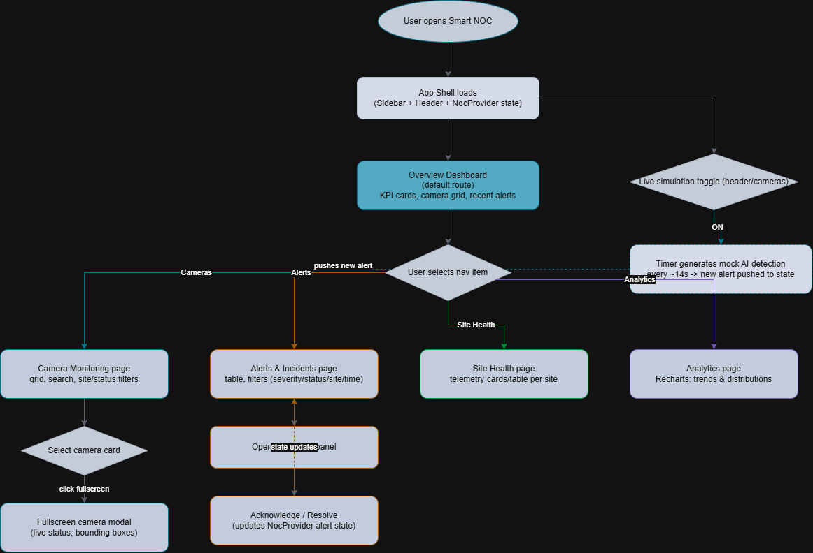

# Smart NOC — Smart Network Operations Center

A frontend prototype demonstrating how Computer Vision and IoT concepts can be applied to telecommunications infrastructure monitoring. Built as an enterprise-style dark-themed dashboard with mock data and local state — no real backend.

## Stack

- Next.js (App Router) + TypeScript
- Tailwind CSS + shadcn/ui-style components (Radix primitives)
- Lucide React icons
- Recharts for analytics

## Features

- **Overview** — KPI cards (sites online, active alerts, AI detections, camera/network availability), live camera grid, recent alerts.
- **Camera Monitoring** — Simulated CCTV feeds with REC indicators, timestamp overlays, AI bounding boxes, detection labels, fullscreen view, site/status search and filters.
- **Alerts & Incidents** — Filterable alert table/panel with severity, status, confidence score, acknowledge/resolve actions, detail panel.
- **Site Health** — Per-site telemetry: network/camera status, temperature, power, CPU, last updated.
- **Analytics** — Recharts visualizations: incidents over time, incident categories, severity distribution, site health distribution, detection trends.
- **Simulated AI events** — A toggleable timer generates new mock detection alerts (Person, Unauthorized Access, Restricted Area Intrusion, PPE Violation, Smoke, Fire) to simulate a live system.

All alert/camera/site data lives in `src/lib/mock-data.ts` and is held in React state via `NocProvider` (`src/components/providers/noc-provider.tsx`) — acknowledging/resolving alerts and toggling live simulation are fully functional against this local state.

## User Flow



An editable version of this diagram is available at `docs/smart-noc-flow.drawio` (open in [app.diagrams.net](https://app.diagrams.net) or the draw.io VS Code/Kiro extension).

## Project Structure

```
src/
  app/                    # Next.js routes (App Router)
  components/
    ui/                   # shadcn-style primitives (button, card, dialog, ...)
    providers/            # NocProvider — shared alert/camera state + simulation timer
    layout/               # Sidebar, header
    dashboard/            # KPI cards, camera cards, alert list, site cards, charts
  lib/
    types.ts              # Shared domain types (Camera, AlertItem, Site, ...)
    mock-data.ts           # Seed data + simulation helpers
    utils.ts               # cn() class helper
```

## Running locally

```bash
npm install
npm run dev
```

Then open http://localhost:3000.

On Windows PowerShell, if `npm` is blocked by the script execution policy, use `npm.cmd install` and `npm.cmd run dev`.

Design direction, dials and the reason behind each choice are in [DESIGN.md](DESIGN.md).

## Notes / Scope

- This is a visual/UX prototype only: there is no backend, no real video feed, and no persistence — refreshing the page resets simulated alerts to the seed data.
- Camera "feeds" are static placeholder images styled with overlays (scanlines, REC dot, bounding boxes) to read as CCTV footage, not live video.
